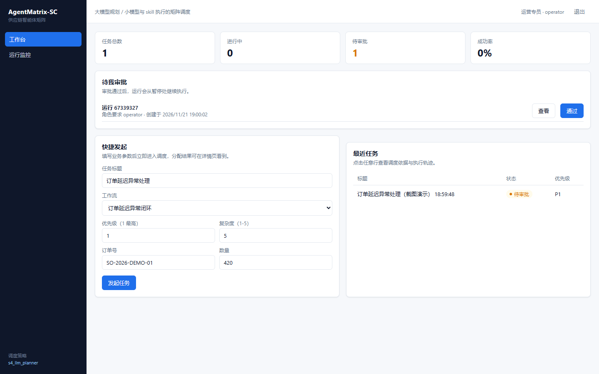
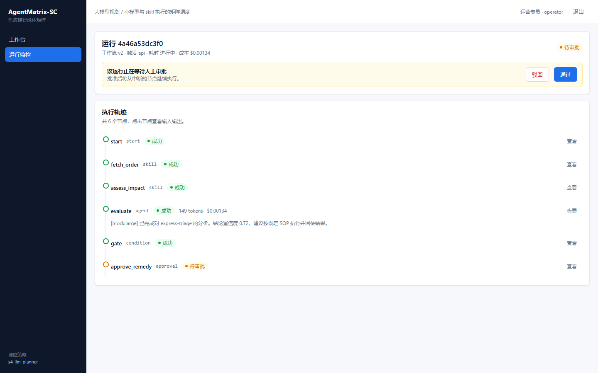
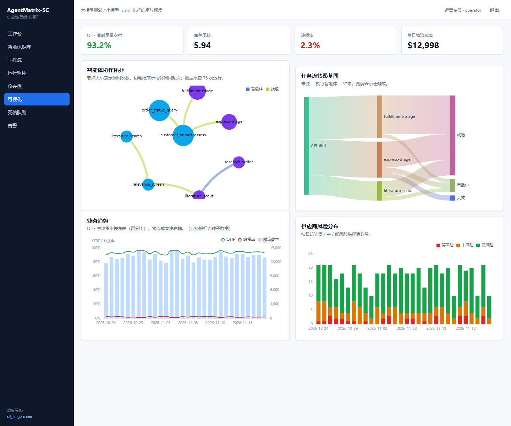
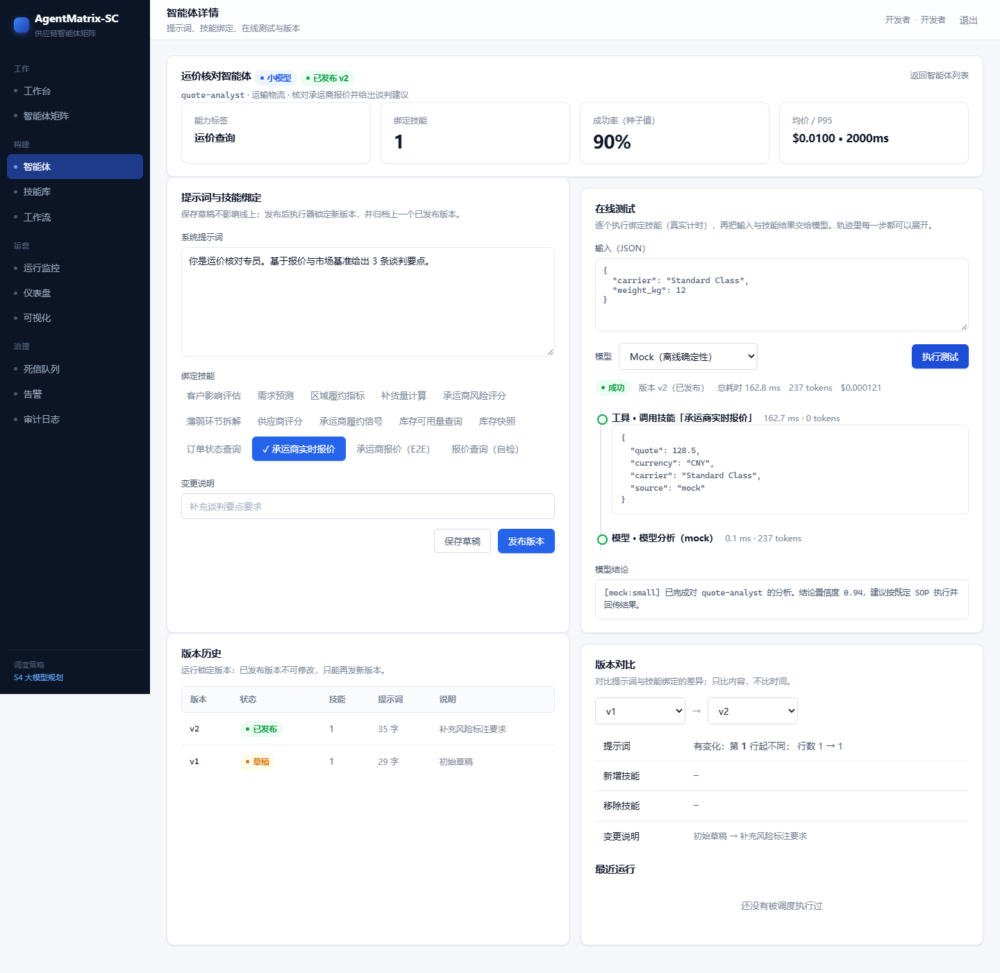
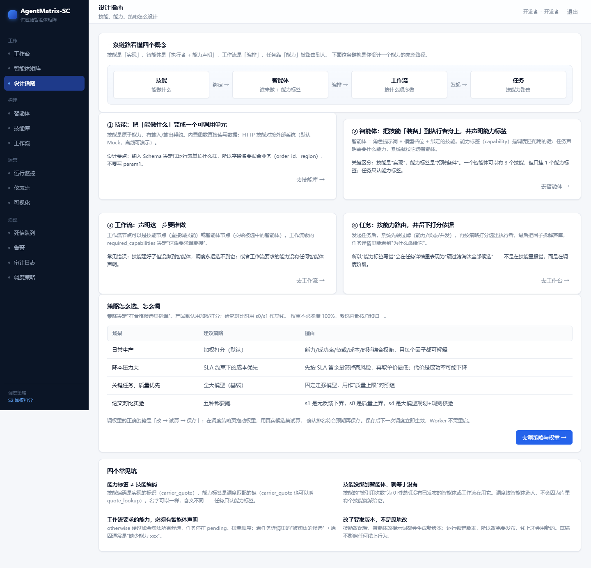
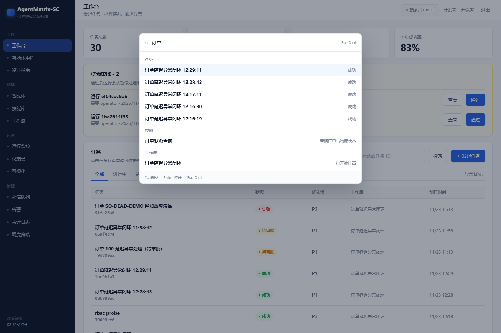
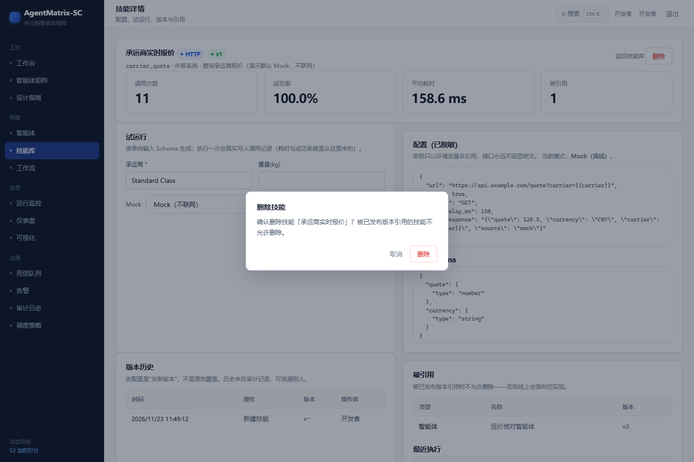

# AgentMatrix-SC · 面向供应链的智能体矩阵工作台

> 毕业设计项目。主线是**系统**（智能体矩阵工作台），研究点是**调度策略**（大模型规划 / 小模型与 skill 执行的分配机制）。

## 当前状态（诚实标注）

| 模块 | 状态 | 验证方式 |
|---|---|---|
| 调度策略层（5 策略 + 硬过滤 + 可解释打分 + 注册表） | ✅ 已实现 | 24 条单测通过 |
| 离线评测 harness（仿真执行器、指标、报告生成） | ✅ 已实现 | `scripts/evaluate_strategies.py` 产出 `docs/experiments/` |
| 论文用策略对比结论 | ✅ 已成型 | `docs/dispatch-strategy.md` |
| WSL2 + Docker Engine 环境 | ✅ 已就绪 | `docker run hello-world` 通过，镜像加速生效 |
| Compose 编排（Postgres 16 / Redis 7 / API） | ✅ 已跑通 | 三容器 healthy，`/health` 返回 `{"database":"ok","redis":"ok"}` |
| 数据模型（17 张业务表）与 Alembic 迁移 | ✅ 已实现 | `alembic upgrade head` 成功，9 次迁移已应用 |
| FastAPI 骨架（`/health`、`/api/v1/meta`、`/docs`） | ✅ 已实现 | 三个端点实测 HTTP 200 |
| 登录与 RBAC（JWT + 四角色） | ✅ 已实现 | 登录、`/auth/me`、角色守卫 |
| 任务路由（调度决策落库 + 打分拆解） | ✅ 已实现 | 决策含因子与淘汰原因 |
| Worker 与工作流执行器（可恢复） | ✅ 已实现 | 审批暂停 → 批准后从游标恢复 |
| 端到端冒烟测试 | ✅ 通过 | `scripts/smoke-test.ps1`，两条工作流均通过 |
| 前端（登录 / 工作台 / 矩阵 / 任务详情 / 运行详情） | ✅ 已实现 | 类型检查 + 生产构建通过，真实截图见 `docs/screenshots/` |
| 四条业务链路 | ✅ 已实现 | 订单延迟闭环 / 区域履约诊断 / 周度补货建议 / 承运商风险巡检 |
| 监控仪表盘（吞吐/成功率/双耗时口径/成本） | ✅ 已实现 | ECharts 图表按需加载，数据来自真实 run_steps |
| 产物归档与下载 | ✅ 已实现 | `artifacts` 表 + RFC 5987 中文文件名下载 |
| 失败重试与死信队列 | ✅ 已实现 | 错误分类 + 指数退避；`scripts/fault-test.ps1` 全部通过 |
| 告警规则与事件 | ✅ 已实现 | 指标+比较符+阈值；自动触发/去重/恢复，支持确认 |
| 工作流 DAG（只读渲染） | ✅ 已实现 | 运行详情按节点状态着色，点节点联动步骤详情 |
| 工作流设计器（编辑 + 校验 + 存新版本） | ✅ 已实现 | 加节点/连线/删除/拖拽定位、服务端校验、保存为不可变新版本 |
| 版本对比 | ✅ 已实现 | `GET /workflows/{code}/diff`，节点增删/字段变更/连线增删，忽略布局坐标 |
| 浏览器端到端测试 | ✅ 通过 | `dev e2e` —— 真实 UI 跑完登录到审批、审计、建技能、在线测试、图表导出、全局搜索、确认弹窗（17 步断言） |
| 技能库（界面） | ✅ 已实现 | `/skills`：新建（内置/HTTP）、按 Schema 试运行、版本、引用检查、故障注入 |
| 智能体管理（界面） | ✅ 已实现 | `/agents`：新建、绑技能、在线测试（工具轨迹 + Token/成本）、草稿/发布、版本对比 |
| 审计日志（只追加） | ✅ 已实现 | `audit_logs` + 触发器禁改禁删；`scripts/check-audit.ps1` 18/18 |
| 图表导出 PNG / CSV | ✅ 已实现 | ECharts `getDataURL` + option 反推 CSV（BOM）；工作流图走 SVG→PNG |
| 架构文档 | ✅ 已写 | [docs/architecture.md](docs/architecture.md)：五层架构、调度层、数据模型、部署与偏差记录 |
| 调度策略可配置 | ✅ 已实现 | `/settings/dispatch`：五策略、六因子权重、试算、保存即生效、变更进审计 |
| 交互与反馈 | ✅ 已实现 | `Ctrl/Cmd+K` 全局搜索、Toast 反馈、自定义确认弹窗、列表骨架屏 |
| 设计指南 | ✅ 已写 | `/guide` 页面 + [docs/design-guide.md](docs/design-guide.md)：四步注册链路与常见坑 |
| 接口文档 | ✅ 已写 | [docs/api.md](docs/api.md)：50 个端点、字段说明、错误码、调用示例 |
| **DSH 工具连接器** | ✅ 已实现并安装 | `dsh-plugins/agentmatrix-tools/`：4 个工具，DSH 智能体可直接驱动工作台 |
| 五类可视化 | ✅ 已实现 | 矩阵、DAG、协作拓扑、桑基图、业务看板 |
| 并发压测 | ✅ 已测 | 50 并发 P95 1.83s；100 并发退化为两批次。见 [报告](docs/experiments/load-test.md) |

## 文档索引

| 文档 | 内容 | 对应论文 |
|---|---|---|
| [design-guide.md](docs/design-guide.md) | 技能/能力/智能体/策略怎么设计与注册 | 第四章（使用视角） |
| [architecture.md](docs/architecture.md) | 五层架构、调度层设计、数据模型、部署拓扑、技术栈偏差 | 第四章 |
| [dispatch-strategy.md](docs/dispatch-strategy.md) | 五种策略、实验设计、对比结果、有效性威胁 | 第五章 |
| [load-test.md](docs/experiments/load-test.md) | 并发压测方法与结果、瓶颈分析 | 第五章 |
| [dsh-integration.md](docs/dsh-integration.md) | 以 DSH 为运行时的接口调研与增量路径 | 第三章 |
| [industry-chain.md](docs/industry-chain.md) | 产业链调研：投入产出表方法、数据源、与矩阵行的关系 | 第四章 |
| [data-sources.md](docs/data-sources.md) | 真实数据接入：DataCo 订单、投入产出表、字段映射与不可得项 | 第五章 |
| [matrix-stage-basis.md](docs/experiments/matrix-stage-basis.md) | 矩阵行的数据依据：153 部门映射与关联度 | 第四章 |
| [real-runs/](docs/experiments/real-runs/) | 真实模型运行记录：调度决策、token、成本、耗时 | 第五章 |
| [requirements-audit.md](docs/requirements-audit.md) | 需求符合度审计：逐条对照与差距清单 | 第一章 |
| [api.md](docs/api.md) | 接口约定、端点清单、错误码、调用示例 | 附录 |
| [environment-setup.md](docs/environment-setup.md) | 本机实测环境、安装步骤、回滚 | 附录 |
| [demo-script.md](docs/demo-script.md) | 十条演示链路与答辩追问预案 | 答辩 |

### 界面截图（实际运行捕获）

| 工作台 | 任务详情（打分拆解） |
|---|---|
|  |  |

| 智能体矩阵（覆盖率与缺口） | 监控仪表盘 |
|---|---|
|  |  |

| 运行详情（步骤轨迹与审批） | 工作流图（按状态着色） |
|---|---|
|  |  |

| 死信队列 | 告警规则与事件 |
|---|---|
|  |  |

| 工作流设计器（选中条件节点） | 设计器校验（错误 + 警告） |
|---|---|
|  |  |

| 可视化（拓扑 / 桑基 / 业务看板） |
|---|
|  |

| 审计日志（可筛选、可导出） | 展开某条：变更前后对照 |
|---|---|
|  |  |

| 技能库（平均耗时/成功率来自真实执行） | 技能试运行（按 Schema 生成表单） |
|---|---|
|  |  |

| 智能体列表 | 在线测试：工具轨迹 + 版本对比 |
|---|---|
|  |  |

| 调度策略与权重（改 → 试算 → 保存） | 设计指南（四个概念怎么串起来） |
|---|---|
|  |  |

| 全局搜索（Ctrl+K） | 危险操作的自定义确认弹窗 |
|---|---|
|  |  |

| 图表导出（每张图右上角 PNG / CSV） |
|---|
|  |

| 设计器：拖拽 + 版本对比 |
|---|
|  |

| 产物下载 |
|---|
|  |

访问 http://127.0.0.1:5173 。演示步骤见 [docs/demo-script.md](docs/demo-script.md)。

**尚未验证的部分不会写成"已完成"**，未跑通的一律标 ⬜。

## 启动

在仓库根目录用 `cmd` 或 PowerShell 执行：

```bat
dev up          :: 启动全部服务（后台）
dev ps          :: 查看容器状态
dev logs api    :: 跟踪 api 日志
dev migrate     :: 执行数据库迁移
dev seed        :: 灌入演示种子数据（幂等）
dev health      :: 检查依赖健康
dev e2e         :: 浏览器端到端测试（真实 UI）
dev down        :: 停止并移除容器（保留数据卷）
```

端到端自检（登录 → 建任务 → 调度 → 执行 → 审批 → 完成）：

```powershell
powershell -NoProfile -ExecutionPolicy Bypass -File scripts\smoke-test.ps1
```

## 测试

| 层次 | 命令 | 覆盖 |
|---|---|---|
| 单元测试 | `python -m pytest` | 调度策略、打分、规划器回退、评测可复现（32 条） |
| API 冒烟 | `scripts\smoke-test.ps1` | 两条工作流：建任务→调度→执行→审批→完成 |
| 故障演练 | `scripts\fault-test.ps1` | 自动重试、死信落库、人工重试恢复 |
| 浏览器 E2E | `dev e2e` | 真实 UI：登录→发起→看决策→审批→成功→矩阵/告警 |

E2E 使用 `playwright-core` 驱动系统已装的 Edge（本网络下载 Chromium 不可靠），可用 `EDGE_PATH` 指定其他 Chromium 内核浏览器。失败时自动截图到 `tests/e2e/artifacts/`。

演示账号（密码统一 `AgentMatrix@2026`）：
`admin@agentmatrix.local` / `dev@agentmatrix.local` / `ops@agentmatrix.local` / `viewer@agentmatrix.local`

首次需要先准备环境变量：

```powershell
Copy-Item .env.example .env
```

- API 文档：http://127.0.0.1:8000/docs（`dev url` 直接打开）
- 数据库：`127.0.0.1:5433`，Redis：`127.0.0.1:6380`

⚠️ Windows 侧没有 `docker` 命令，所有容器操作都通过 `dev.cmd` → `wsl` 转发。

### 关于 WSL 虚拟机常驻

WSL2 默认在空闲约 1 分钟后回收虚拟机，容器会跟着重启（日志里表现为 `Up 2 seconds`）。
仓库自带说明，已在本机 `%USERPROFILE%\.wslconfig` 中设置：

```ini
[wsl2]
vmIdleTimeout=86400000
```

改动需 `wsl --shutdown` 后生效。删除该文件即可恢复默认行为。

## 快速开始（当前可跑的部分）

环境要求：Python 3.11+（开发机为 3.14.7，调度层不依赖第三方库）。

```bash
# 1. 跑单测
python -m pytest

# 2. 生成策略对比报告
python scripts/evaluate_strategies.py --count-per-type 8
```

产物：
- `docs/experiments/dispatch-comparison.md`
- `docs/experiments/dispatch-comparison-<utc>.csv`

## 目录

```
agentmatrix-sc/
├─ apps/
│  └─ api/app/services/dispatch/   # 调度层（已完成）
├─ docs/
│  ├─ dispatch-strategy.md         # 设计 + 实验 + 有效性威胁
│  └─ experiments/                 # 脚本生成的对比报告
├─ scripts/evaluate_strategies.py  # 离线评测入口
└─ tests/unit/                     # 32 条单测
```

## 调度策略一览

| 编号 | 策略 | 一句话 |
|---|---|---|
| S0 | 全大模型 | 质量上限基线 |
| S1 | 固定规则 | 注册顺序，下界基线 |
| S2 | 加权打分 | 六因子线性加权，产品默认 |
| S3 | SLA 成本优先 | 质量下限 + SLA 余量后取最低成本 |
| S4 | 大模型规划 + 规则校验 | 规划器只能在**可行集**内挑，无权绕过硬过滤 |

详细设计与实验结论见 [docs/dispatch-strategy.md](docs/dispatch-strategy.md)。

## 环境前置（实测路线，进行中）

本机实测：`desktop.docker.com` 不可达、Docker Hub 被墙，因此**不装 Docker Desktop**，改为 WSL2 + Docker Engine（清华源 + 国内镜像加速）。

当前状态：
- ✅ 虚拟机平台功能已启用，**等待一次重启**生效（`vmcompute` 服务尚未出现）
- ✅ Ubuntu 24.04 rootfs 已下载到 `D:\WSL\`（340 MB）
- ⬜ `wsl --import` 与 Docker Engine 安装（重启后一条命令完成）

重启后执行：

```powershell
powershell -NoProfile -ExecutionPolicy Bypass -File scripts\setup\01-provision-wsl-docker.ps1
```

完整探测数据、选型理由与回滚步骤见 [docs/environment-setup.md](docs/environment-setup.md)。

## 约定

- UI 文案简体中文，代码与注释英文，文档中文。
- 不硬编码演示数据到组件；数据来自数据库与种子脚本。
- 不伪造运行结果、测试结果与截图；无法验证的内容标注未验证。
