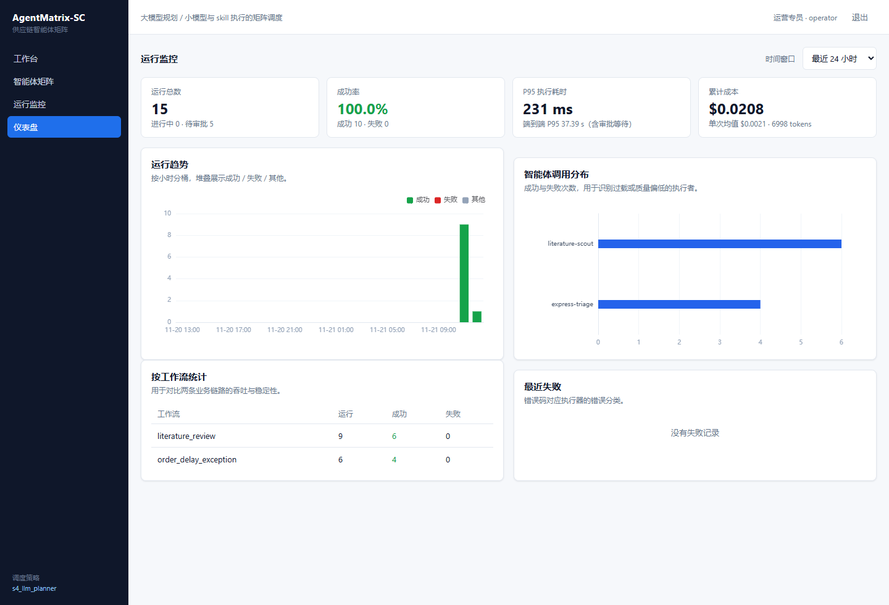
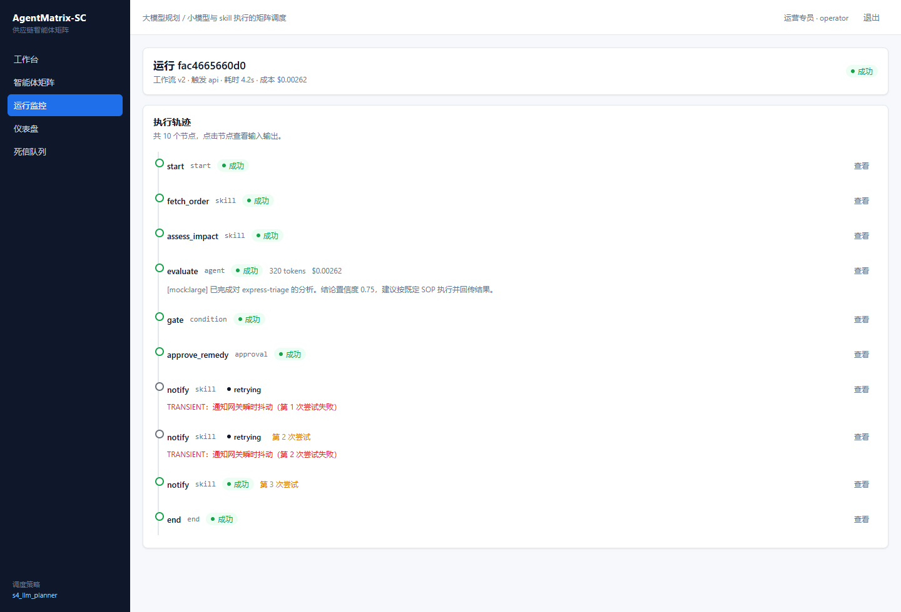

# AgentMatrix-SC · 面向供应链的智能体矩阵工作台

> 毕业设计项目。主线是**系统**（智能体矩阵工作台），研究点是**调度策略**（大模型规划 / 小模型与 skill 执行的分配机制）。

## 当前状态（诚实标注）

| 模块 | 状态 | 验证方式 |
|---|---|---|
| 调度策略层（5 策略 + 硬过滤 + 可解释打分 + 注册表） | ✅ 已实现 | 32 条单测通过 |
| 离线评测 harness（仿真执行器、指标、报告生成） | ✅ 已实现 | `scripts/evaluate_strategies.py` 产出 `docs/experiments/` |
| 论文用策略对比结论 | ✅ 已成型 | `docs/dispatch-strategy.md` |
| WSL2 + Docker Engine 环境 | ✅ 已就绪 | `docker run hello-world` 通过，镜像加速生效 |
| Compose 编排（Postgres 16 / Redis 7 / API） | ✅ 已跑通 | 三容器 healthy，`/health` 返回 `{"database":"ok","redis":"ok"}` |
| 数据模型（11 张业务表）与 Alembic 迁移 | ✅ 已实现 | `alembic upgrade head` 成功，两次迁移已应用 |
| FastAPI 骨架（`/health`、`/api/v1/meta`、`/docs`） | ✅ 已实现 | 三个端点实测 HTTP 200 |
| 登录与 RBAC（JWT + 四角色） | ✅ 已实现 | 登录、`/auth/me`、角色守卫 |
| 任务路由（调度决策落库 + 打分拆解） | ✅ 已实现 | 决策含因子与淘汰原因 |
| Worker 与工作流执行器（可恢复） | ✅ 已实现 | 审批暂停 → 批准后从游标恢复 |
| 端到端冒烟测试 | ✅ 通过 | `scripts/smoke-test.ps1`，两条工作流均通过 |
| 前端（登录 / 工作台 / 矩阵 / 任务详情 / 运行详情） | ✅ 已实现 | 类型检查 + 生产构建通过，真实截图见 `docs/screenshots/` |
| 科研流程链路（文献检索与综述生成） | ✅ 已实现 | 冒烟测试通过，可下载综述草稿产物 |
| 监控仪表盘（吞吐/成功率/双耗时口径/成本） | ✅ 已实现 | ECharts 图表按需加载，数据来自真实 run_steps |
| 产物归档与下载 | ✅ 已实现 | `artifacts` 表 + RFC 5987 中文文件名下载 |
| 失败重试与死信队列 | ✅ 已实现 | 错误分类 + 指数退避；`scripts/fault-test.ps1` 全部通过 |

### 界面截图（实际运行捕获）

| 工作台 | 任务详情（打分拆解） |
|---|---|
|  |  |

| 智能体矩阵（覆盖率与缺口） | 监控仪表盘 |
|---|---|
|  |  |

| 运行详情（步骤轨迹与审批） | 重试轨迹（同节点 3 次尝试） |
|---|---|
|  |  |

| 死信队列 | 产物下载 |
|---|---|
|  |  |

访问 http://127.0.0.1:5173 。演示步骤见 [docs/demo-script.md](docs/demo-script.md)。

**尚未验证的部分不会写成"已完成"**，未跑通的一律标 ⬜。

## 启动

在仓库根目录用 `cmd` 或 PowerShell 执行：

```bat
dev up          :: 启动全部服务（后台）
dev ps          :: 查看容器状态
dev logs api    :: 跟踪 api 日志
dev migrate     :: 执行数据库迁移
dev seed        :: 灌入演示种子数据（幂等）
dev health      :: 检查依赖健康
dev down        :: 停止并移除容器（保留数据卷）
```

端到端自检（登录 → 建任务 → 调度 → 执行 → 审批 → 完成）：

```powershell
powershell -NoProfile -ExecutionPolicy Bypass -File scripts\smoke-test.ps1
```

演示账号（密码统一 `AgentMatrix@2026`）：
`admin@agentmatrix.local` / `dev@agentmatrix.local` / `ops@agentmatrix.local` / `viewer@agentmatrix.local`

首次需要先准备环境变量：

```powershell
Copy-Item .env.example .env
```

- API 文档：http://127.0.0.1:8000/docs（`dev url` 直接打开）
- 数据库：`127.0.0.1:5433`，Redis：`127.0.0.1:6380`

⚠️ Windows 侧没有 `docker` 命令，所有容器操作都通过 `dev.cmd` → `wsl` 转发。

### 关于 WSL 虚拟机常驻

WSL2 默认在空闲约 1 分钟后回收虚拟机，容器会跟着重启（日志里表现为 `Up 2 seconds`）。
仓库自带说明，已在本机 `%USERPROFILE%\.wslconfig` 中设置：

```ini
[wsl2]
vmIdleTimeout=86400000
```

改动需 `wsl --shutdown` 后生效。删除该文件即可恢复默认行为。

## 快速开始（当前可跑的部分）

环境要求：Python 3.11+（开发机为 3.14.7，调度层不依赖第三方库）。

```bash
# 1. 跑单测
python -m pytest

# 2. 生成策略对比报告
python scripts/evaluate_strategies.py --count-per-type 8
```

产物：
- `docs/experiments/dispatch-comparison.md`
- `docs/experiments/dispatch-comparison-<utc>.csv`

## 目录

```
agentmatrix-sc/
├─ apps/
│  └─ api/app/services/dispatch/   # 调度层（已完成）
├─ docs/
│  ├─ dispatch-strategy.md         # 设计 + 实验 + 有效性威胁
│  └─ experiments/                 # 脚本生成的对比报告
├─ scripts/evaluate_strategies.py  # 离线评测入口
└─ tests/unit/                     # 32 条单测
```

## 调度策略一览

| 编号 | 策略 | 一句话 |
|---|---|---|
| S0 | 全大模型 | 质量上限基线 |
| S1 | 固定规则 | 注册顺序，下界基线 |
| S2 | 加权打分 | 六因子线性加权，产品默认 |
| S3 | SLA 成本优先 | 质量下限 + SLA 余量后取最低成本 |
| S4 | 大模型规划 + 规则校验 | 规划器只能在**可行集**内挑，无权绕过硬过滤 |

详细设计与实验结论见 [docs/dispatch-strategy.md](docs/dispatch-strategy.md)。

## 环境前置（实测路线，进行中）

本机实测：`desktop.docker.com` 不可达、Docker Hub 被墙，因此**不装 Docker Desktop**，改为 WSL2 + Docker Engine（清华源 + 国内镜像加速）。

当前状态：
- ✅ 虚拟机平台功能已启用，**等待一次重启**生效（`vmcompute` 服务尚未出现）
- ✅ Ubuntu 24.04 rootfs 已下载到 `D:\WSL\`（340 MB）
- ⬜ `wsl --import` 与 Docker Engine 安装（重启后一条命令完成）

重启后执行：

```powershell
powershell -NoProfile -ExecutionPolicy Bypass -File scripts\setup\01-provision-wsl-docker.ps1
```

完整探测数据、选型理由与回滚步骤见 [docs/environment-setup.md](docs/environment-setup.md)。

## 约定

- UI 文案简体中文，代码与注释英文，文档中文。
- 不硬编码演示数据到组件；数据来自数据库与种子脚本。
- 不伪造运行结果、测试结果与截图；无法验证的内容标注未验证。
